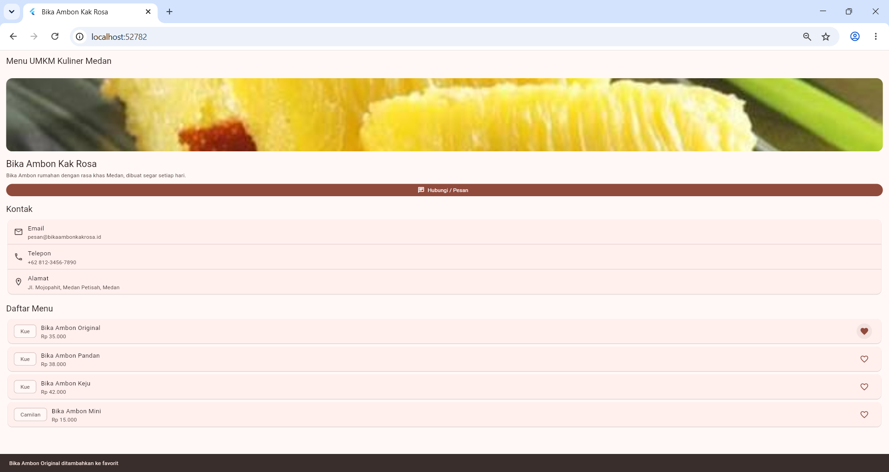
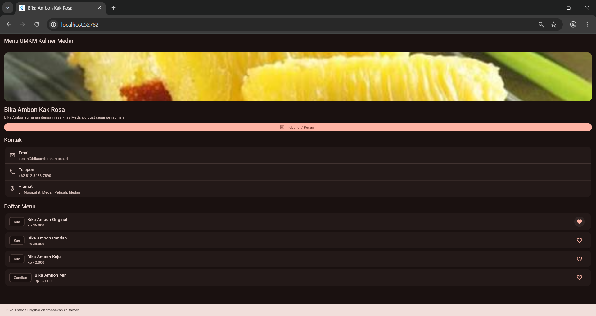

# Tugas Rutin 5: Halaman Menu UMKM Kuliner Medan

## Identitas
- Nama: Jhon Gabriel Simarmata
- NIM: 4243550020
- Kelas: PSIK 24C

## Tangkapan layar



## Diagram widget tree
```text
MenuUmkmApp [Stateless]
└── MaterialApp
    └── HalamanMenu [Stateless]
        └── Scaffold
            ├── AppBar
            └── ListView
                ├── Header (gambar, identitas usaha, tombol pesan)
                ├── Card kontak
                └── KartuMenu x4 [Stateless]
                    └── TombolFavorit [Stateful]
```

## Penjelasan (150–250 kata)
Pada aplikasi ini, saya memahami widget tree sebagai susunan konfigurasi UI yang immutable. Objek widget dibuat kembali saat build() berjalan, tetapi itu tidak berarti seluruh tampilan digambar ulang dari awal. Element tree menjadi penghubung widget dengan tampilan yang sedang hidup. Element dapat bertahan saat konfigurasi widget diperbarui, menyimpan State untuk widget Stateful, dan menjadi tempat BuildContext berasal. Render tree menangani pekerjaan visual: menghitung ukuran dan posisi layout, lalu menggambar hasilnya ke layar.

MenuUmkmApp saya buat Stateless karena hanya menetapkan tema dan halaman awal. HalamanMenu juga Stateless karena menyusun konten tetap serta daftar menu konstan, tanpa state interaksi yang berubah. KartuMenu Stateless karena menerima nama, harga, dan kategori melalui parameter, lalu menampilkannya. Sebaliknya, TombolFavorit perlu Stateful karena menyimpan satu bool _favorit yang berubah saat pengguna menekan ikon. Dengan begitu, bagian Stateful tetap sekecil mungkin. Saat setState() dipanggil, element tombol ditandai kotor dan build() dipanggil ulang. Widget baru kemudian dibandingkan dengan konfigurasi lama; framework memperbarui bagian yang berubah saja, bukan seluruh aplikasi. Saya memakai const pada widget dan data yang tetap agar objek konfigurasi bisa digunakan kembali dan pembuatan ulang yang tidak perlu berkurang.

## Pernyataan penggunaan AI
Dalam pengerjaan tugas ini, saya membuat kode aplikasi (lib/ dan test/) berdasarkan spesifikasi Tugas Rutin 5. Saya menggunakan AI agent di VS Code sesekali sebagai alat bantu ketika menemukan kesulitan selama proses pengerjaan. Setelah aplikasi selesai dibuat, saya menjalankan dan mengujinya menggunakan flutter analyze dan flutter test. Saya juga memeriksa kembali kode serta hasil aplikasi untuk memastikan semuanya berjalan sesuai harapan.